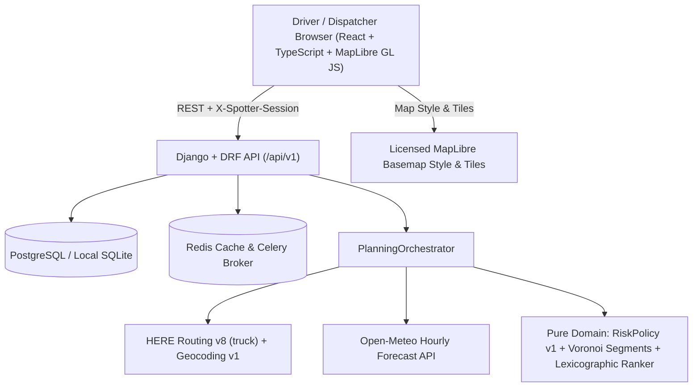

# Spotter — Weather-Aware Truck Routing

Enterprise-grade, weather-aware truck routing full-stack application built with **React + TypeScript + MapLibre GL JS** and **Django + Django REST Framework**.

> **Authoritative specifications:** Original brief in [`reference/fs-assessment-spotter.pdf`](reference/fs-assessment-spotter.pdf), design system in [`docs/04_DESIGN.md`](docs/04_DESIGN.md), executable risk policy in [`docs/06_RISK_AND_RECOMMENDATION.md`](docs/06_RISK_AND_RECOMMENDATION.md), and external API key / account setup in [`docs/PREREQUISITES_AND_KEYS.md`](docs/PREREQUISITES_AND_KEYS.md).

---

## Architecture Overview

Spotter uses a **modular monolith** with strict domain isolation (`backend/domain/` has zero Django, DRF, or HTTP client dependencies) and centralized backend ownership of all safety calculations:



### Repository Structure

```text
spotter-weather-truck-routing/
├── backend/
│   ├── config/              # Env-validated Django settings (fail-closed prod), URLs, structured logging, error envelope
│   ├── domain/              # Pure Python (stdlib only): risk policy, units, classifier, polyline, sampling, ETA, Voronoi segments, ranker
│   ├── providers/           # Ports, resilient HTTP client (SSRF allowlist, retries, circuit breaker), HERE & Open-Meteo adapters, fixture adapters
│   ├── infrastructure/      # Deterministic cache keys, HMAC guest session scopes, Prometheus metrics
│   ├── services/planning/   # Composition root, PlanningOrchestrator, optional Celery task
│   ├── apps/trips/          # Models, migrations, strict DRF serializers, scoped throttles, /api/v1 views
│   ├── tests/               # 169 unit, provider contract, API integration & security tests
│   └── Dockerfile
├── frontend/
│   ├── src/
│   │   ├── app/             # AppShell, TopBar, HelpPolicyModal, MobileBottomSheet (3-position), AppProviders
│   │   ├── features/        # trip-planner, route-comparison, map-experience (persistent MapLibre), weather-timeline (0–48h)
│   │   ├── shared/          # API client, typed DTOs, risk theme tokens, formatting, accessible UI primitives
│   │   ├── styles/          # docs/04_DESIGN.md CSS tokens + reduced-motion support
│   │   └── tests/           # 13 Vitest + React Testing Library interaction & formatting tests
│   └── Dockerfile
├── docs/                    # Architecture, design system, risk policy, ADRs, acceptance checklist, key procurement guide
├── .github/workflows/ci.yml # Parallel backend + frontend + security-hygiene CI pipeline
├── docker-compose.yml       # PostgreSQL 16 + Redis 7 + Django API + optional Celery worker + Frontend Nginx
├── Makefile                 # Unified developer commands
└── .env.example             # Validated environment variable template (no secrets)
```

---

## Safety & Risk Policy (`risk-policy-v1`)

All weather severity classification, payload overrides, eligibility gates, and lexicographic rankings are computed exclusively on the backend (`backend/domain/risk/policy.py` & `backend/domain/recommendation/ranker.py`):

| Metric | Low (`0`) | Moderate (`1`) | High (`2`) | Severe (`3`) | No Travel (Ineligible) |
|---|---|---|---|---|---|
| **Wind (mph)** | `< 25` | `>= 25, < 35` | `>= 35, < 45` | `>= 45, < 55` | `>= 55` |
| **Rain (in/hr)** | `< 0.10` | `>= 0.10, < 0.25` | `>= 0.25, < 0.50` | `>= 0.50, <= 1.00` | `> 1.00` |
| **Snow (in/hr)** | `< 0.5` | `>= 0.5, < 1.0` | `>= 1.0, < 2.0` | `>= 2.0, <= 3.0` | `> 3.0` |

- **Strict Load Overrides:**
  - `wind >= 55 mph` → **No Travel** (any load)
  - `45 <= wind < 55 mph` **and** `load > 30,000 lb` → **No Travel**
  - `35 <= wind < 45 mph` **and** `load > 40,000 lb` → **Severe**
- **Fail-Closed Guarantees:** Any `No Travel` segment or `unknown` / missing / out-of-horizon weather disqualifies a route from being recommended (`recommended_route_id = null`). Missing values are never coerced to `0`.
- **Internal vs. Display Sampling:** Internal risk scoring always uses conservative `<= 10 mi` checkpoints plus endpoints (`INTERNAL_SCORING_MILES=10`). Changing UI display spacing (`10 / 25 / 50 mi`) changes visible markers without weakening safety scoring or changing rankings.
- **Lexicographic Ranking (eligible routes only):** `Severe miles` → `High miles` → `Weighted average risk (0–3)` → `Travel duration` → deterministic route ID.
- **Honest Forecast Semantics:** Checkpoint ETAs show truck-arrival weather; the 0–48h corridor heatmap slider shows wall-clock exploratory forecast relative to `departure_at` (`reference_kind="departure_instant"`). Forecast data is modeled guidance and never claims a route is guaranteed safe.

---

## Quick Start (Local Development)

### Prerequisites
- Python **3.11+** and [`uv`](https://docs.astral.sh/uv/)
- Node.js **22+** (tested on Node 24 LTS) and `npm`
- Optional: Docker & Docker Compose for PostgreSQL 16 + Redis 7

### 1. Configure Environment
```bash
cp .env.example .env
```
By default, `.env.example` starts in explicitly labeled **`DATA_MODE=fixture`** mode so you can run, test, and inspect the full application locally without external credentials (the UI displays a prominent **Sample data (Fixture mode)** badge).

To enable **live HERE truck routing, HERE geocoding, Open-Meteo weather, and a licensed MapLibre basemap**, follow [`docs/PREREQUISITES_AND_KEYS.md`](docs/PREREQUISITES_AND_KEYS.md) and set `DATA_MODE=live` in your local `.env` (never commit `.env`).

### 2. Run Backend & Frontend
```bash
# Install dependencies & migrate local DB
make setup
make migrate

# Terminal 1 — Django API (http://localhost:8000, Swagger at /api/docs/)
make dev-backend

# Terminal 2 — React + Vite SPA (http://localhost:5173)
make dev-frontend
```

Or run the full stack via Docker Compose (PostgreSQL + Redis + Backend + Frontend):
```bash
make docker-up
```

---

## Verification & Quality Gates

All automated checks below were executed directly on this codebase:

```bash
# Backend checks
cd backend
uv run ruff check .                                        # All checks passed
uv run mypy .                                              # 0 errors across 62 files
uv run python manage.py check                              # 0 issues
uv run python manage.py makemigrations --check --dry-run   # No changes detected
uv run pytest -v                                           # 169 passed (118 unit, 29 integration, 22 security)

# Frontend checks
cd frontend
npm run typecheck                                          # 0 errors
npm run lint                                               # 0 errors, 0 warnings
npm run test -- --run                                      # 13 passed (4 test files)
npm run build                                              # Production Vite bundle built cleanly
```

---

## External Keys, Licensing & Remaining Deployment Blockers

This repository contains **no secrets**. To run in `DATA_MODE=live` or deploy to production, the repository owner must provision:
1. **HERE Developer API Key** (`HERE_API_KEY`) with Routing API v8 (Truck) and Geocoding & Search v1 enabled.
2. **Weather Provider Plan** (`OPEN_METEO_BASE_URL` / optional `OPEN_METEO_API_KEY`) — note that Open-Meteo's free tier is **non-commercial only**; commercial deployments require a paid plan or licensed weather provider.
3. **Licensed MapLibre Basemap Style & Tiles** (`VITE_MAP_STYLE_URL`, optional domain-restricted `VITE_MAP_PUBLIC_TOKEN`) — MapLibre GL JS is only a client renderer, not a tile host.
4. **Hosting & Managed Services** (Static CDN for frontend, Python runtime for Django API, PostgreSQL 16, Redis 7, strong `DJANGO_SECRET_KEY`).

See [`docs/PREREQUISITES_AND_KEYS.md`](docs/PREREQUISITES_AND_KEYS.md) and [`docs/17_ACCEPTANCE_CHECKLIST.md`](docs/17_ACCEPTANCE_CHECKLIST.md) for the complete procurement guide and verified completion status.
