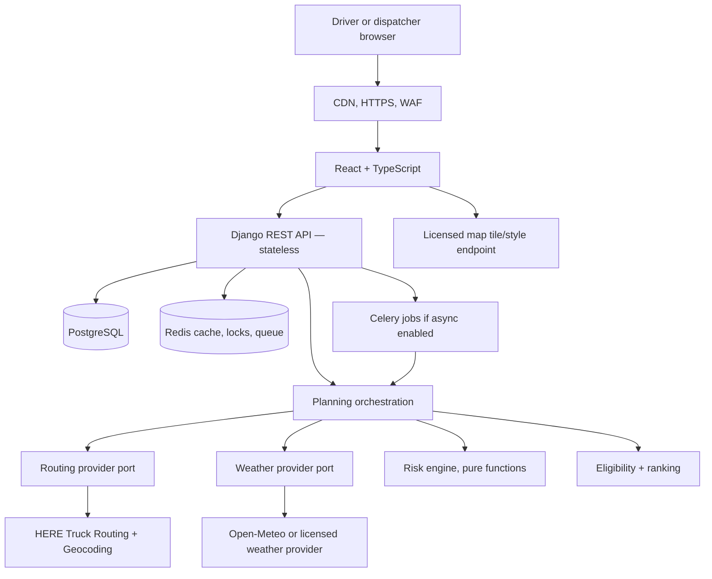
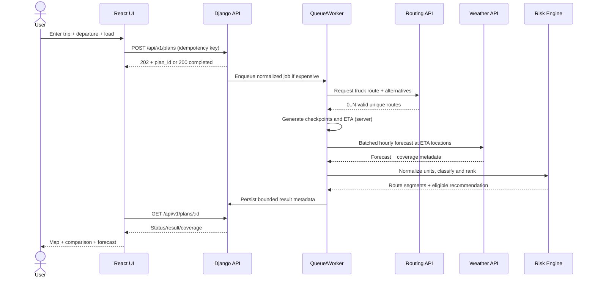

# 02 — Enterprise pragmatic architecture (HLD + LLD boundaries)

## Architecture decision

Use a **modular monolith**: one React SPA, one Django/DRF application, one database, one Redis, optional Celery worker replicas. Scale stateless API and workers independently when data justifies it. Keep modules replaceable through contracts rather than deploy-everything-as-microservices.



## Backend module map

```text
backend/
  config/                # settings, URL routing, OpenAPI, health checks
  apps/trips/            # trip DTO, persistence, access policies, REST views
  domain/risk/           # immutable forecast -> severity + reasons
  domain/routing/        # polyline, distance sampling, ETA, segments
  domain/recommendation/ # coverage, risk miles, stable lexicographic rank
  providers/routing/     # HERE adapter and typed port
  providers/geocoding/   # geocoding adapter and typed port
  providers/weather/     # weather adapter, units, timestamps, bulk fanout
  services/planning/     # orchestration and coordination
  infrastructure/cache/  # normalized cache keys and TTL
  infrastructure/jobs/   # idempotency, retries, progress, result persistence
  tests/                 # pure, contract and integration tests
```

**Ports (examples):** `RouteProvider.get_alternatives(trip, vehicle) -> list[Route]`; `WeatherProvider.get_hourly(points, window) -> ForecastBatch`; `PlanService.plan(request) -> PlanResult`. Define dataclasses/Pydantic/typed model equivalents consistent with actual repo, inject adapters in a central composition root, and keep domain modules free from DRF/provider SDK imports.

## Transaction/process sequence



If the first implementation is fast enough and resource-constrained, synchronous request execution can be acceptable as long as the API contract remains coherent; introduce worker queue behind the same service boundary after profiling. **Never** claim async architecture is implemented merely because documented.

## Data flow and invariants

1. User input is validated and normalized (coords, UTC departure, load in pounds).
2. Geocoding resolves human input to coordinates; disambiguation is user-driven, not a silent first-result pick.
3. Routing provider returns valid truck routes. Deduplicate route IDs/geometries; preserve provider warnings and restrictions.
4. Segment geometry into continuous, distance-weighted units. Generate internal scoring checkpoints at configured conservative resolution, plus endpoints, independent of UI spacing.
5. ETA comes from route's cumulative provider timing where available; use documented approximation only when absent and declare reduced fidelity.
6. Fetch forecast at the estimated time of arrival. Validate variable availability, sampling horizon, unit conversions and model timestamps.
7. Classify hazards and load overrides using immutable policy; classify unknown separately from Low.
8. Score lengths by condition, compute eligibility, lexicographic comparison and explainable reasons.
9. Return a ready-to-render normalized result; UI should never need to recompute core safety logic.
10. Heatmap time slices are a separate *visualization* view: a forecast at an arbitrary slider time does not retroactively change the trip-arrival recommendation unless a new plan is calculated.

## Error boundaries

| Error | Backend behavior | UI behavior |
|---|---|---|
| No routes | terminal `no_routes` | route-unavailable explanation |
| Fewer routes | valid partial route set | accurate count, no placeholder cards |
| Provider rate limit | bounded retry/backoff, report `provider_busy` | retry affordance; no invented data |
| Forecast partial | mark unknown coverage | no unsafe 'recommended' badge |
| ETA outside forecast | `forecast_out_of_range` | cannot rate that portion |
| All routes No Travel | `no_eligible_route` | high-visibility warning |
| Async job timeout | recorded retry/fail state | explicit timeout + safe retry |
| Cache stale | freshen or flag stale with timestamp | do not present stale as current |

## Capacity and scaling

- Separate **fast read path** (GET results) from **slow compute path** (provider fanout).
- Cache provider results by normalized coordinates/time bucket/provider version/routing constraints; never accidentally mix different vehicle weights or modes.
- Use Redis request coalescing to prevent thundering herds; idempotency keys to avoid accidental duplicate jobs.
- Enforce bounded active plans per identity/IP, bounded provider concurrency, queue length and job TTL.
- Keep plan IDs opaque; protect results against cross-user enumeration. Expire saved location data promptly.
- Base autoscaling decisions on real p95/p99 duration, queue wait, provider quota, memory and error rates; not fictional user counts.

## Deployment variants

- **Assessment MVP:** SPA static host, Django API, provider integrations; PostgreSQL and Redis/Celery added only if needed.
- **Production-oriented:** redundant API replicas, Celery worker replicas, managed Postgres/Redis, CDN/WAF, secrets manager, monitoring and rollback.
- Use environment variables for all deploy-time values. Document actual runtime choices in an ADR, not as unverified facts.
