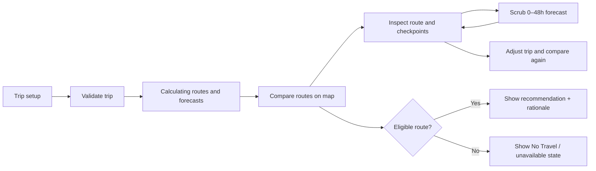
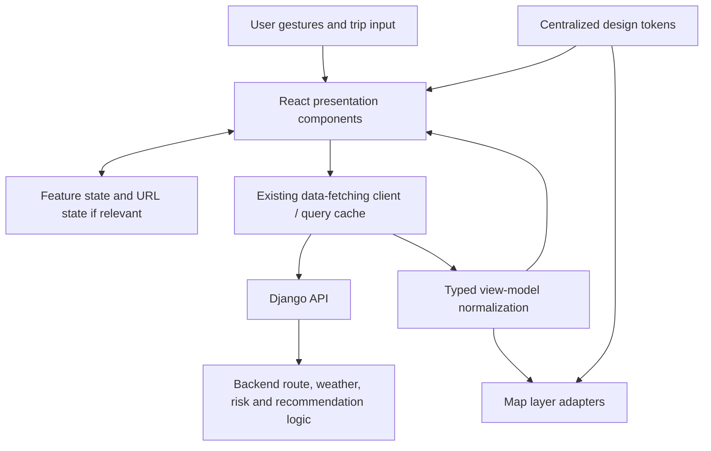

# SPOTTER — PREMIUM PRODUCT UI / UX DESIGN SYSTEM

**Design handoff:** Senior product designer + staff frontend engineer standards  
**Product:** Weather-Aware Truck Routing  
**Stack in scope:** React + TypeScript frontend, Django backend, map/routing/weather services  
**Document type:** Executable visual specification / design-engineering contract  
**Version:** 1.0 — November 2026  
**Status:** Proposed design direction, not an implemented UI

> **The north star:** Make Spotter feel like a thoughtful, premium operational product built by an experienced human product team. Borrow Apple's restraint, typography, visual hierarchy and meaningful motion; borrow the smooth, confident interaction quality seen in modern Google product experiences such as the Google Antigravity website. **Do not clone either brand.** Translate those qualities into an original, credible truck-routing interface.
>
> **Important clarification:** “3D” means *subtle visual depth, dimensional surfaces and spatial continuity* — **not** spinning 3D objects, exaggerated tilt effects, parallax everywhere, or a game-like dashboard.

---

## 01 — Design philosophy and non-negotiables

### The desired feeling

Five words: **Quiet. Precise. Useful. Premium. Trustworthy.**

When a driver or dispatcher opens the app, they should understand the job immediately: enter a trip, compare weather risk, and choose a responsible route. Richness comes from **composition, contrast, hierarchy, material, feedback and finishing**, not from decorative excess.

| Inspiration | What we adopt | What we do **not** copy |
|---|---|---|
| Apple product web experiences | Editorial spacing, exceptional typography, refined surface lighting, carefully timed transitions, focus on one thing at a time | Brand identity, product photography, site composition, proprietary assets or gimmicky scroll choreography |
| Apple interface guidance | Meaningful motion, obvious affordances, reduced-motion support, uncluttered UI | Platform-only patterns that compromise a cross-platform web app |
| Google / Antigravity website feel | Smooth transitions, expressive yet coherent visual storytelling, clean component rhythm, polished hover/focus states | Site-specific graphics, copied motion sequences, dramatic animation in safety-critical contexts |
| Enterprise fleet software | Data density when justified, resilient states, keyboard access, explicit units, fast task completion | Legacy visual clutter, overcrowded tables, multiple competing CTAs |

### Ten design laws

1. **The map is the hero after a search.** The route-planning controls never permanently compete with it.
2. **Information before decoration.** Safety severity, uncertain weather, ETAs and units are immediately legible.
3. **Motion proves causality.** Something moves to show what changed or where information came from.
4. **Depth is hierarchical.** Only an active panel, selected route, or transient popover receives elevated treatment.
5. **One primary action per state.** Avoid multiple equally bright buttons.
6. **No invented data.** Never render demo values as live weather, ETA or safe-route advice.
7. **Make operational states explicit.** Loading, stale, unavailable, partial and unsafe are not the same state.
8. **Use design tokens everywhere.** No scattered hardcoded styling, magic z-index values or unversioned animation curves.
9. **Prefer existing app contracts/components.** Extend rather than replace functioning constructors, hooks, provider integrations, routing or auth flows.
10. **Every flourish must survive the accessibility and performance budget.** Remove it if it worsens usability.

### Quality bar

The UI must **not** look like a generic AI-generated dashboard: no anonymous purple-to-blue gradients, alternating-card grids without purpose, dozens of pills, glowing outlines on every surface, animation on every element, giant stock truck photos, fake analytics or excessive glassmorphism.

---

## 02 — Scope and fidelity to the assessment

The original *Spotter Full Stack Developer — Weather-Aware Truck Routing* brief requires:

- Trip inputs: **origin, destination, departure date/time, load weight**.
- **Three route options** requested from a routing API; handle fewer genuinely distinct routes honestly.
- Weather samples every **10 / 25 / 50 miles**, associated with estimated arrival time at the checkpoint.
- Classify weather and apply load-based overrides in the **backend**.
- Recommend by **fewest Severe miles → fewest High miles → lowest average risk → shortest travel time**.
- Show routes, checkpoints, severity, ETA and summaries on a map.
- Show weather conditions along the route corridor with a **0–48-hour forecast slider**.
- Prioritize smooth map/heatmap rendering as much as routing correctness: each accounts for 40% of the assessment evaluation.

**Scope boundaries:** The assessment does not require sign-in, dispatch management, billing, vehicle telemetry or an animation-heavy marketing website. Do not add them merely to make the product appear enterprise-grade. The UI may be an elegant single-workspace product with optional compact introductory states.

### Safety constraints reflected in the UI

| Weather | Low | Moderate | High | Severe | No Travel |
|---|---|---|---|---|---|
| Wind (mph) | <25 | 25–34 | 35–44 | 45–54 | ≥55 |
| Rain (in/hr) | <0.10 | 0.10–0.25 | 0.25–0.50 | 0.50–1.00 | >1.00 |
| Snow (in/hr) | <0.5 | 0.5–1.0 | 1.0–2.0 | 2.0–3.0 | >3.0 |

**Additional wind overrides:** ≥55 mph is No Travel at any load; 45–54 mph with >30,000 lb is No Travel; 35–44 mph with >40,000 lb is Severe. The design must present the computed category and explanation received from the backend, not reimplement risk boundaries in UI code. Source interval notation has ambiguous shared endpoints in some ranges; the backend's versioned policy must define and test exact numeric boundary behavior and return the resolved classification.

**Critical safety copy:** Never claim a route is “safe” or “guaranteed safe.” Prefer **“Recommended based on available forecast”**, **“Lower forecast risk”**, **“No eligible route”**, or **“Weather coverage incomplete.”** If all candidates contain No Travel segments, show an explicit warning and **do not** decorate any route as recommended.

---

## 03 — Original visual concept: *Navigational Intelligence*

A modern route intelligence cockpit that feels like a premium native utility, not a heavy logistics admin dashboard.

### Visual metaphor

- **The map is the canvas:** large, quiet, clear, full-bleed inside its workspace.
- **The planner is an instrument panel:** a crisp white surface with disciplined spacing and just enough elevation.
- **Selected routes have presence:** gentle dimensional separation, a precise line highlight, and a subtle transition into detail.
- **Weather feels spatial:** translucent corridor overlays, discrete checkpoint dots and an unobtrusive time scrubber.
- **Content carries the mood:** strong headings, concise summaries, small purposeful typography, accurate color semantics.

### Brand direction

The reference assessment PDF uses a dark teal Spotter header. Honor that existing visual cue while modernizing it into a restrained product language. Use a neutral canvas and selective deep teal accents. Risk colors must be reserved for actual route/weather risk, not decoration.

### 3-level depth system (not literal 3D)

| Level | Description | Typical usage | Visual behavior |
|---|---|---|---|
| Base / 0 | Matte canvas, no apparent elevation | Map, app background, dividers | Static, quiet |
| Lifted / 1 | Soft edge separation + small diffuse shadow | Planner panel, selected route card | Minor elevation on interaction |
| Overlay / 2 | Focused floating surface, stronger separation, restrained blur *if supported* | Checkpoint detail popover, mobile bottom sheet, menu | Enters from a logically connected origin |

**Do not use:** 3D transforms on the actual map container, perspective rotation of safety information, neon glows, spinning truck models or perpetual parallax. Optional 1–2 px hover elevation is enough.

---

## 04 — Information architecture and screen journey



**A user should reach a useful route comparison without visiting a separate landing page.** If desired, the first-time empty state can contain one very short editorial headline, but the form is always immediately available.

### Four user-facing states

1. **Ready to plan:** clear input surface, calm map placeholder or geographic context, concise explanation of what Spotter does.
2. **Processing:** preserve user inputs; show phase-specific progress text, not fictitious percentages or loaders that never end.
3. **Results:** route cards + map + checkpoint and forecast tools; this is the canonical experience.
4. **Exception:** no route, provider failure, stale/partial forecast, No Travel, missing coverage; each state has the correct recovery action.

### Progressive disclosure

Show only critical data in route summaries: suitability status, duration, distance, severe/high miles and one-line explanation. Show complete checkpoint-level wind/rain/snow data only after the user selects a route or checkpoint. Avoid a giant diagnostics table by default.

---

## 05 — Desktop layout: map-first cockpit

### 1440 px desktop art direction (illustrative wireframe; not final measurements)

```text
┌──────────────────────────────────────────────────────────────────────────────┐
│ Spotter [symbol]                  Weather-aware routing         Help / Units │
├───────────────────────┬──────────────────────────────────────────────────────┤
│ PLAN YOUR TRIP        │                                        Map controls  │
│                       │             FULL-SIZE ROUTE MAP                      │
│ From  [             ] │                                                      │
│ To    [             ] │        A —— ● —— ● —— ● —— Destination                 │
│ Depart[date][time]    │          \                    /                       │
│ Load  [     ] lb      │           B —— ● —— ● —— ● —/                         │
│ Samples [10|25|50mi]  │                                                      │
│ [ Compare routes   ]  │               Selected route + risk-color segments   │
│                       │                                                      │
│ ROUTE COMPARISON      │                                ┌──────────────────┐  │
│ ┌───────────────────┐ │                                │ Checkpoint detail│  │
│ │ Route A [selected]│ │                                └──────────────────┘  │
│ │ forecast rationale│ │                                                      │
│ └───────────────────┘ │                                                      │
│ ┌───────────────────┐ │                                                      │
│ │ Route B           │ │                                                      │
│ └───────────────────┘ │                                                      │
│ ┌───────────────────┐ │                                                      │
│ │ Route C           │ │                                                      │
│ └───────────────────┘ │                                                      │
│                       │  ┌────────────────────────────────────────────────┐  │
│                       │  │ Forecast  [ 0 ───●──────────── 48 hours ]     │  │
│                       │  │ Valid forecast time / legend / confidence      │  │
│                       │  └────────────────────────────────────────────────┘  │
└───────────────────────┴──────────────────────────────────────────────────────┘
```

**Composition specification:**

- App shell: slim, quiet header; use it only for logo, product descriptor and utilitarian controls.
- Left column: stable planning/comparison rail, approximately 360–420 px at spacious desktop widths, **configurable by responsive tokens**; scroll internally if needed.
- Right column: dominant map canvas taking available space; no decorative cards floating over the route line.
- Floating layers: checkpoint detail close to the clicked marker and a compact forecast timeline near the bottom of the map with safe margins.
- Route cards: short, comparison-oriented, strong selected state, no giant charts.
- When viewport is too small for a meaningful map, move the comparison region to tabs/drawer rather than squashing the map.

### Design emphasis by state

| State | Primary visual anchor | Secondary anchor | What remains quiet |
|---|---|---|---|
| Before plan | Planner form | Very light map / explanation | Empty data areas |
| Loading | Clear progress phase | Dimmed, stable map canvas | Animation |
| Results | Recommended/selected route on map | Route comparison rail | Header and decoration |
| Risk warning | Warning summary + relevant segments | Route details | Any celebratory motion |
| Forecast exploration | Active timestamp + corridor overlay | Route geometry and markers | Unrelated cards |

---

## 06 — Mobile and tablet: deliberately designed, not shrunken desktop

### Tablet (approximately 768–1199 px)

- Map remains visually dominant.
- Planner becomes a narrower collapsible side drawer or split-panel when room permits.
- Route summaries can appear in a compact horizontal selection tray.
- Checkpoint detail uses an anchored panel with enough space to prevent obstruction.
- The time scrubber sits inside a bottom control rail without covering native map attribution.

### Mobile (below approximately 768 px)

```text
┌─────────────────────────┐
│ Spotter        [Trip]    │
├─────────────────────────┤
│                         │
│    FULL-VIEW MAP        │
│                         │
│   highlighted route     │
│                         │
│                         │
│ [0h ───●────── 48h]     │
├─────────────────────────┤
│ ━━━  drag handle        │
│ Recommended based on... │
│ Route A  •  Duration    │
│ Severe mi / High mi     │
│ [Compare 3 routes]      │
└─────────────────────────┘
```

Use a **three-position bottom sheet** for route summaries: peek, half, expanded. Implement with accessible focus handling and predictable touch/keyboard interactions. On narrow screens the input flow can open in a full-screen form with an obvious Close/Back; the map must not be forced into a tiny box. Keep primary controls reachable within mobile touch zones.

### Input ergonomics

- Location inputs have accessible autocomplete suggestions and unambiguous selection.
- Date/time display the applicable timezone and use standard controls when possible.
- Load weight shows explicit unit (`lb` for assessment), parsed numeric value and validation.
- Checkpoint spacing uses a compact segmented control: **10 / 25 / 50 mi**.
- Avoid custom animated selectors where native controls are easier to operate.

---

## 07 — Typography: editorial precision

### Typeface strategy

Use a well-tested system font stack first for fast loading and a polished cross-platform appearance. Where branding requires a web font, use a licensed, variable, optimized typeface with appropriate fallbacks.

```css
:root {
  --font-ui: ui-sans-serif, -apple-system, BlinkMacSystemFont, "Segoe UI", Inter, sans-serif;
  --font-mono: ui-monospace, "SFMono-Regular", Consolas, monospace;
}
```

**Scale (starting design tokens, tuned through testing):**

| Role | Desktop target | Mobile target | Use |
|---|---|---|---|
| Page title / editorial intro | 36–44 px, tracking -0.035em | 28–34 px | Single-purpose intro only |
| Section heading | 21–24 px, semibold | 19–21 px | Planner and route comparison |
| Route title | 17–18 px, semibold | 16–18 px | Candidate identity |
| Body | 14–16 px | 15–16 px | Labels, explanations, errors |
| Operational metadata | 12–13 px | 12–14 px | Distances, ETAs, units |
| Data emphasis | 20–28 px, tabular figures | 19–24 px | Duration / risk mileage |

Do not use hairline text. Ensure readable numeric alignment (`font-variant-numeric: tabular-nums`). Reserve letter-spaced uppercase for the smallest handful of navigation/section captions. Avoid displaying an entire screen in tiny light-gray text.

---

## 08 — Color system, semantics and tokens

### Art-directed palette

The following are **design tokens**, not business rules or fixed values scattered through components. Treat them as a proposed starting theme and contrast-test the final palette.

| Token | Proposed value | Role |
|---|---|---|
| `canvas` | `#F5F7F6` | Soft neutral product background |
| `surface` | `#FFFFFF` | Planner and cards |
| `surface-muted` | `#EEF3F2` | Subtle input fills / chips |
| `ink` | `#17282B` | Primary text |
| `ink-secondary` | `#56686B` | Explanatory text |
| `line` | `#DCE5E3` | Borders, dividers |
| `brand-deep` | `#073D45` | Brand anchor, primary button |
| `brand-action` | `#126B75` | Selection and interactive accent |
| `focus` | `#166BCA` | Focus ring distinct from hazards |

### Weather severity semantics

Risk colors must be distinguishable and accompanied by text/symbols. Proposal:

| Severity | Color intent | Example label treatment |
|---|---|---|
| Low | Quiet green | “Low risk” + green swatch |
| Moderate | Warm amber | “Moderate” + amber swatch |
| High | Saturated orange | “High risk” + orange swatch |
| Severe | Deep red | “Severe” + red swatch |
| No Travel | Dark maroon + conspicuous icon | “No Travel” + warning pictogram |
| Unknown / missing | Gray dashed pattern | “Forecast unavailable” |

A risk color must never be the only communication method. Route line colors should prioritize **risk severity on the selected route**, while unselected candidates use subdued neutral/contrasting outlines. Do not use green to mean “recommended” if the route still contains significant hazards.

### Elevation and radii

- Cards: radii roughly **12–16 px**, soft border, restrained shadow.
- Main planner: **16–20 px** edge radius or integrated panel edges depending on shell.
- Buttons/inputs: coherent **10–12 px** radii; do not mix six radius styles.
- Popovers: **14–18 px**, level-2 elevation.
- Thin borders are often preferable to deep shadows for enterprise clarity.

### CSS custom property example

```css
:root {
  --color-canvas: #F5F7F6;
  --color-surface: #FFFFFF;
  --color-surface-muted: #EEF3F2;
  --color-ink: #17282B;
  --color-ink-secondary: #56686B;
  --color-border: #DCE5E3;
  --color-brand-deep: #073D45;
  --color-brand-action: #126B75;
  --color-focus: #166BCA;

  --space-unit: 4px;
  --radius-control: 12px;
  --radius-card: 16px;
  --radius-overlay: 18px;

  --shadow-lifted: 0 8px 26px rgba(7, 40, 44, 0.075);
  --shadow-overlay: 0 18px 55px rgba(7, 40, 44, 0.15);

  --duration-feedback: 120ms;
  --duration-panel: 260ms;
  --duration-emphasis: 400ms;
  --ease-standard: cubic-bezier(0.2, 0, 0, 1);
  --ease-enter: cubic-bezier(0, 0, 0.15, 1);
}

@media (prefers-reduced-motion: reduce) {
  :root {
    --duration-feedback: 0ms;
    --duration-panel: 0ms;
    --duration-emphasis: 0ms;
  }
}
```

Extend these tokens in a single theme module; do not copy values throughout JSX, stylesheets, map layers and chart configuration. Semantic risk colors should come from a versioned UI theme mapping with corresponding labels, never from duplicated threshold calculations.

---

## 09 — The motion language: *Quiet Continuity*

**Inspired by premium Apple/Google product interactions, but optimized for an operational routing workflow.** The experience should feel smooth and natural even when a user does not consciously notice the animation.

### Motion principles

1. **Continuity:** the detail panel emerges from the selected checkpoint or route context.
2. **Cause and effect:** a card selection updates the matching route immediately.
3. **Small distance:** 4–12 px shifts are enough for most UI surfaces.
4. **No layout jitter:** avoid large relayouts; prefer opacity/transform for decorative transitions.
5. **Input first:** typing, dragging and map gestures have priority over choreography.
6. **One focal motion at a time:** weather/route changes should not trigger simultaneous unrelated flourishes.
7. **Respect preferences:** reduce/disable nonessential motion with `prefers-reduced-motion`.

### Motion specification

| Interaction | Transition | Suggested duration | Easing | Guardrail |
|---|---|---:|---|---|
| Button hover/focus | Color/shadow only, max ~1–2 px lift | 100–160 ms | Standard | No bounce / flashing |
| Input focus | Border/focus ring fades in | 100–150 ms | Standard | Focus always visible |
| Route card selection | Gentle border + surface change, map selected route emphasis | 180–260 ms | Standard | Selection state updates immediately |
| Planner panel expand/collapse | Short spatial slide + opacity | 220–320 ms | Standard | Preserve form values |
| Checkpoint popover | Small fade + 6–10 px translate | 160–220 ms | Enter | Never cover essential warning |
| Mobile bottom sheet | Gesture-tracked translation / short settle | 240–360 ms | Contextual spring or standard | No oscillation after settle |
| Progress step label | Cross-fade label | 120–180 ms | Standard | Real phases only |
| Time slider drag | Map overlay changes aligned to interaction | During drag | Direct manipulation | Throttle rendering, not input |
| Forecast frame settle | Layer opacity interpolation if data ready | 120–220 ms | Standard | No misleading interpolation of actual values |
| First visit reveal | One restrained fade/translate of planner shell | 350–500 ms maximum | Enter | Skip on repeated navigation or reduced motion |

**These are design targets, not physics hardcoded in each component.** Centralize durations/easing in theme tokens and adjust based on device tests.

### Motion choreography — one example

**Selecting Route B**

1. Click/keyboard selection instantly changes `aria-pressed` or the appropriate selection semantic state.
2. Route B card receives a precise outline + restrained elevated state (no glowing border).
3. Map emphasizes Route B while dimming unselected routes; selected geometry and viewport are shown without a sudden jump.
4. Summary numbers change with a simple cross-fade **only when the underlying values differ**; never use animated count-ups for risk miles.
5. If the checkpoint panel is open for another route, close or update it predictably and restore a sensible focus target.
6. Do **not** refetch weather merely because the selection changed if it is already available in the analysis result.

### Scroll behavior

- On the app workspace, **do not** recreate a scroll-jacking marketing site.
- Standard natural scrolling and internal panel scrolling are preferred.
- Reserve one-time reveal motion for the initial planner state; after that, responsiveness is more important than storytelling.
- A separate marketing/portfolio landing page could use restrained editorial scroll reveals, but that is **not required** for this assessment.

### Spatial depth / 3D nuance

Allow occasional **subtle perspective cues** in empty-state illustrations or the selected card shadow, but not on risk-critical data. CSS 3D transforms, WebGL 3D hero effects and real-time 3D terrain are explicitly **not required**. The map is already rich spatial content.

### Reduced motion behavior

Disable parallax, large translations, auto-playing animation and nonessential 3D effects. Keep affordance states, contrast, selection text and focus indicators. Never hide an error only because its animated entrance has been disabled.

---

## 10 — Component-by-component design contract

### A. Header / top bar

**Content:** Spotter mark, small product description, unit control / help as appropriate.  
**Look:** Quiet, flat, faint divider, ample alignment, no glossy gradient.  
**Motion:** None except standard hover/focus state.  
**Engineering:** Do not introduce navigation pages that are not needed.

### B. RoutePlannerForm

**Inputs:** Origin, destination, departure local date/time, load weight, checkpoint spacing.  
**States:** idle, editing, invalid, submitting, disabled-as-needed, retryable error.  
**Look:** Confident labels, generous control size, crisp focus; minimal placeholders.  
**Interaction:** location suggestions with keyboard navigation; sensible validation before submission.  
**Copy:** primary button “Compare routes.”  
**Engineering:** react-hook-form or existing form solution + schema validation; preserve user input across job updates; don't duplicate DTO validation logic as domain rules.

### C. RouteComparisonCard

**Content, in priority order:** route identifier, recommendation/eligibility state, travel time and distance, Severe miles, High miles, average risk and one sentence of reason.  
**Selected state:** strong outline + clearer elevation + matching highlighted map path.  
**Nonselected state:** neutral surface; still fully readable and clickable.  
**No Travel state:** warning text, reason, disabled recommendation treatment while remaining inspectable.  
**Motion:** 180–260 ms small elevation/border transition; don't animate safety numbers.  
**Engineering:** fully data-driven from versioned backend result; pure presentational component; stable key per route.

### D. RouteMapCanvas

**Default:** visually quiet basemap, appropriately styled roads/labels and crisp route shapes.  
**Route hierarchy:** selected route foreground, alternates lower contrast, checkpoints legible at usable zoom.  
**Risk:** selected route segments colored by backend classification, not arbitrary style gradients.  
**Selection:** click route or card, maintain synchronized selection via shared state.  
**Engineering:** isolate map instance; update layer sources and feature state where possible rather than remounting the map; fit bounds only for new route selections when appropriate; preserve map gestures.

### E. WeatherCheckpointMarker + DetailPopover

**Marker:** small but perceivable symbol; selected marker receives an enlarged halo or outline, not animated pulsing.  
**Detail:** checkpoint distance, arrival ETA and timezone, wind, rain, snow, risk label, forecast timestamp and any coverage caveat.  
**Motion:** short anchored entry/exit, no scale explosion.  
**Engineering:** accessible keyboard navigation to corresponding checkpoint list item; on mobile, show detail in bottom sheet rather than tiny popover.

### F. ForecastTimeline

**Range:** 0–48 h from the available forecast reference time, with unambiguous timezone/date labels.  
**Look:** precision slider, sparse ticks, active time emphasized, legend close to map.  
**Action:** thumb drag changes display time; backend recommendation remains based on the modeled trip ETAs, not the exploratory heatmap slider.  
**Engineering:** use pre-fetched frames when reasonable; schedule updates on animation frames; throttle costly overlay work; debounce network requests when necessary; never call a weather API per slider pixel.

### G. ForecastCorridorOverlay

**Look:** bounded, translucent corridor presentation with readable route geometry above it; clear legend for risk/weather dimension.  
**States:** active timestamp, missing grid values, data refresh, out-of-range, partial forecast.  
**Engineering:** avoid heavyweight DOM markers for dense datasets; prefer map layers / WebGL where available, cache/time-slice data, decouple visualization resolution from safety calculation resolution.

### H. SafetyNotice

**Look:** prominent, sober, immediate. No bouncing icon, celebratory green or dismissible overlay concealing risk.  
**Content:** exact policy outcome from backend, affected mileage/segment when known, and clear alternatives such as adjusting departure or inspecting routes.  
**Engineering:** announce high-priority changes through appropriately restrained live regions; ensure notices aren't dropped during transitions.

### I. ResultSkeleton / ErrorState / EmptyState

Use geometry-matched skeletons for panels and stable map placeholders; no 10-second shimmer. Error copy must explain the reason category and recovery action. Empty states should be intentionally composed, not surrounded by many fake KPI cards.

---

## 11 — Map and weather visualization rules

1. **Keep geographic truth intact.** Do not distort geometry to make a route more attractive.
2. **Do not imply confidence that does not exist.** An unavailable forecast is gray/patterned and labeled, not green.
3. **Differentiating concerns:** risk-colored route segments vs the exploratory forecast overlay must have clear legends and layer priority.
4. **Selection is visible in more than color:** width, contrast, outline, labels and linked card state.
5. **No giant heatmap glow:** weather overlay opacity should be strong enough to inspect but weak enough to see roads/route lines.
6. **Keep ETA semantics explicit:** checkpoint ETAs are trip-arrival times; slider time is forecast inspection time; label them distinctly.
7. **Small-screen clipping:** keep attribution, zoom/navigation controls and active thumb visible outside safe areas and fixed overlays.
8. **Only show three if three real route candidates exist.** Never fabricate route variation.
9. **Do not weaken risk evaluation when display spacing changes.** If internal safety scoring uses denser sampling, make that separate from UI checkpoint density.
10. **Color mapping comes from a centralized UI risk palette,** not from the routing API payload as arbitrary CSS.

---

## 12 — Detailed UX state matrix

| App state | UI presentation | Primary action | Motion policy |
|---|---|---|---|
| No trip entered | Polished planner and understated guidance | Compare routes | Minimal entry reveal once |
| Invalid inputs | Inline actionable validation at fields | Correct values | Focus feedback only |
| Planning submitted | Preserve form, phase indicator and stable canvas | Cancel if supported | Static/progress cross-fade |
| Routes ready | Route cards, map, checkpoint layers and slider | Inspect/select route | Soft linked emphasis |
| Selected route changed | Updated map/card selection and rationale | Compare alternatives | Short controlled transition |
| Checkpoint focused | Anchored popover/detail sheet | Close / next checkpoint | Small spatial transition |
| Forecast scrub | Active timestamp + overlay | Move slider | Immediate smooth render |
| Forecast incomplete | Visible coverage warning | Inspect gaps or retry | No misleading success motion |
| All routes No Travel | Serious notice, routes still inspectable | Adjust departure/review | No celebratory animation |
| Routing/weather API error | Specific message + retry | Retry | Static or simple fade |
| Session expired, if auth exists | Preserve draft where safe, informative recovery | Sign in / retry | No decor |
| Offline / intermittent network | Nonblocking connection state, truthful data staleness | Retry | Minimal |

**Exception policy:** A failure to gather required weather data cannot silently result in a recommended route. UI must reflect backend eligibility and coverage quality explicitly.

---

## 13 — Frontend engineering architecture

Use the **existing app architecture if present** and migrate incrementally; the structure below is a recommended target, not a mandate to rewrite working code.

```text
src/
  app/
    AppShell.tsx
    providers/                 # existing query, theme and router providers
  features/
    trip-planner/
      components/
      hooks/
      schema/
    route-comparison/
      components/
      selectors/
    map-experience/
      components/
      layers/
      hooks/
    forecast-timeline/
      components/
      hooks/
    safety-notices/
      components/
  shared/
    api/                       # existing HTTP client, typed contracts
    ui/                        # accessible shared primitives
    design-tokens/             # colors, spacing, typography, motion
    utils/                     # formatting, timezones, units
    types/
  styles/
    globals.css
```

### Separation of responsibilities



- **Backend owns** route generation, checkpoint ETAs, weather acquisition, severity, load overrides, segment risk, ranking and eligibility.
- **Frontend owns** layout, input experience, selection, visibility, exploration time, formatting, accessibility and view-state transitions.
- **Existing providers/services** remain authoritative. Reuse existing API clients, query hooks, components and constructors before adding replacements.
- **Never hardcode sample routes, ETAs, hazards or mileage as production defaults.** Use typed mocks only in isolated Storybook/test fixtures clearly marked as test data.
- **Do not silently mutate server results** to make the UI visually nicer.

### Typed view-model boundary (illustrative; adapt to existing DTO)

```ts
// Mapping layer only. Match existing Django response schema rather than
// forcing a backend contract rewrite for a UI redesign.
type Severity = 'low' | 'moderate' | 'high' | 'severe' | 'no_travel' | 'unknown';

type RouteSummaryView = {
  id: string;
  label: string;
  eligibility: 'eligible' | 'no_travel' | 'incomplete';
  isRecommended: boolean;
  durationSeconds: number | null;
  distanceMeters: number | null;
  severeMeters: number | null;
  highMeters: number | null;
  averageRisk: number | null;
  rationale: string | null;
};
```

**Dynamic implementation discipline:** Units, localization, locale-aware numbers, risk labels, map style URLs, motion preferences, supported sampling options and feature flags belong in centralized configuration/derived contracts. Map design uses semantic tokens but never duplicates backend risk thresholds.

### State design

Use a simple explicit state machine or discriminated union for `idle | validating | queued | processing | ready | partial | failed`, with well-defined transitions. Avoid chains of unrelated booleans (`isLoading`, `hasRoutes`, `hasError`, `isEmpty`) that can produce impossible combinations. Maintain selected `routeId` and `checkpointId` separately from immutable analysis results.

---

## 14 — Rendering, performance and device strategy

### Priorities

**First priority:** responsive route interaction and correct risk presentation.  
**Second priority:** smooth map pan/zoom and forecast scrubbing.  
**Third priority:** decorative motion.

### Implementation guidance

- Lazy-load heavy map code after the application shell; prefetch intelligently where real use supports it.
- Memoize normalized route geometry, avoid re-creating entire GeoJSON data sources on unrelated form edits, and preserve the map instance.
- Use map-native layers for many checkpoints/heatmap points, not hundreds of React DOM popups.
- Use requestAnimationFrame to coalesce visual updates during direct manipulation.
- Precompute/cache nearby forecast frames where affordable; on-demand fetches should be debounced and abortable.
- Use virtualization only when checkpoint lists are long enough to justify it.
- Keep animations to composited properties (`transform` and `opacity`) when possible; avoid animating width/height/top/left on complex layouts.
- Avoid excessive real-time blur/backdrop filters over large map surfaces, which can be expensive on integrated GPUs.
- Defer nonessential celebratory/editorial animation until critical map work is idle — and remove it if it causes jank.
- Build responsive breakpoints around actual layout failure rather than arbitrary device labels.
- Measure user-perceived performance on real mid-tier laptops and mobile devices; a high-end development machine is not the acceptance criterion.

### Proposed engineering targets (measure, do not assume)

- Core Web Vitals: aim for **LCP ≤2.5 s, INP ≤200 ms, CLS ≤0.1 at p75** on relevant tested conditions.
- Map interaction: aim for smooth **~60 fps where hardware permits**, graceful degradation where it does not.
- Slider: interaction feedback follows the pointer/finger even if the forecast overlay is still rendering.
- Controls: no blocking animation after route selection or input submission.
- Render budget: profile with React DevTools and browser performance tools; optimize observed hotspots rather than indiscriminate memoization.

### Loading composition

Prefer a quiet skeleton that reserves the final panel/map dimensions. Surface real backend phases if available (e.g., fetching routes, checking forecasts, calculating risk), but **never invent percentages or exact ETAs**.

---

## 15 — Accessibility: a mandatory part of the visual quality

- Target **WCAG 2.2 AA**, including adequate contrast and visible focus states.
- Support full keyboard navigation of planning controls, route cards, checkpoint list and slider.
- Prefer native semantic elements with correct ARIA relations; only use custom gesture widgets if they are equally accessible.
- Touch targets should be comfortably sized (aim ~44 × 44 CSS px for primary touch controls where appropriate).
- Screen readers must hear severity label, units, route identifier, status, and ETA in a meaningful order.
- A keyboard route selection must update an accessible textual summary; not only the map.
- Color alone is insufficient for risk; include text/pattern/shape.
- Respect `prefers-reduced-motion` and avoid flashing effects.
- Check focus restoration after dialogs, popovers and bottom sheets; prevent background focus trapping errors.
- Prevent error messages from disappearing while being read; do not animate their visibility away.
- Support zoom up to 200% without hiding core actions; inspect narrow and landscape layouts.

---

## 16 — Content design and microcopy

Writing should feel confident and concise, never marketing-heavy inside a safety tool.

| Instead of | Use |
|---|---|
| “Discover the magic of smarter travel!” | “Compare routes against forecast conditions.” |
| “Perfect route found!” | “Recommended based on available forecast.” |
| “Safe to drive” | “Lower forecast risk among available routes.” |
| “Oops! Something went wrong” | “We couldn't retrieve the route forecast. Try again.” |
| “Loading magic…” | “Checking weather along your route…” |
| “No data” | “Forecast unavailable for 2 checkpoints.” *(only if backend reports it)* |
| “Bad route” | “No Travel conditions detected.” |

Numbers must be unambiguous: `45 mph`, `30,000 lb`, `12 mi Severe`, `4 hr 18 min`, `Tue 9:30 AM CDT`. Format by locale and source time zone; the examples above are copy patterns only, not actual result data. Display confidence/coverage limitations in plain language.

---

## 17 — QA acceptance and visual review checklist

### A. Visual finish

- [ ] Spacing is optically aligned throughout and follows consistent tokens.
- [ ] Exactly one primary visual focal point exists per state.
- [ ] Map remains central after the user searches.
- [ ] Typography creates hierarchy without depending on gratuitous size variation.
- [ ] Shadows and border radii are consistent; depth is meaningful.
- [ ] Brand color is reserved, not applied to every element.
- [ ] All icons are stylistically consistent and have real meaning.
- [ ] No generic gradient hero, random chart, emoji decoration or stock illustration.
- [ ] Loading and error states are as carefully designed as the success state.

### B. Interaction / motion

- [ ] Route-card and map selection stay synchronized in both directions.
- [ ] Animations support spatial continuity without delaying functional updates.
- [ ] No perpetual decorative loops, oversized hover lifts, bounce or scroll hijacking.
- [ ] Selected-route transitions do not lose map context.
- [ ] Mobile sheet is predictable with pointer, touch, keyboard and screen reader.
- [ ] Forecast slider remains responsive even under network or GPU pressure.
- [ ] Reduced-motion behavior removes spatial animations but keeps clarity.
- [ ] Errors and No Travel warnings never appear delayed or minimized for aesthetics.

### C. Logic-integrity handoff

- [ ] UI displays three real distinct options **when the provider supplies them**; fewer routes are truthfully described.
- [ ] 10 / 25 / 50 mi are genuine selectable checkpoint presentation/sample options as defined by the backend contract.
- [ ] Each checkpoint shows its weather at the estimated time of arrival.
- [ ] Wind/rain/snow severity and load overrides match the backend, including boundary and units tests.
- [ ] Recommendation reflects Severe miles → High miles → average risk → travel time.
- [ ] Incomplete coverage is not labeled Low and cannot silently become “recommended.”
- [ ] Forecast slider changes exploratory map display without silently changing base trip recommendation.
- [ ] Existing auth, routing, geocoding, weather, map layers and UI integration tests continue to work.

### D. Device / accessibility / performance review

- [ ] Test 320 px, 375 px, 768 px, 1024 px, 1440 px and wide monitor layouts.
- [ ] Test reduced motion, 200% zoom, keyboard, touch and screen-reader navigation.
- [ ] Inspect light-mode contrast and map legibility in bright conditions.
- [ ] Check map/heatmap responsiveness under throttled CPU/network.
- [ ] Core Web Vitals and map frame performance are profiled and reported.
- [ ] No animation causes repeated layout thrashing or renders the whole route map from scratch.

---

## 18 — Build sequence for the implementation team

### Phase 1 — Visual foundations (P0)

- Inventory current React components, API DTOs, map layers and existing styles before changing them.
- Establish tokens, typography, grid, accessible primitives and responsive shell.
- Implement high-fidelity **trip setup** and **results** layout in static test fixtures (clearly test-only).
- Obtain visual sign-off at desktop and mobile widths.

### Phase 2 — Correct data-connected experience (P0)

- Wire the existing planning flow to production route/forecast DTOs.
- Implement route cards, selected-route synchronization, ETA/checkpoint detail and safety states.
- Ensure risk mapping is backend-driven and never duplicated in UI logic.
- Add all failure and incomplete-coverage states before animations.

### Phase 3 — Premium interaction layer (P1)

- Add short panel/card transitions and contextual checkpoint entry.
- Introduce forecast scrubber smoothness and map overlay transitions.
- Add responsive mobile sheet interactions.
- Verify reduced-motion and low-end device behavior.

### Phase 4 — Hardening and review (P1)

- Run keyboard/contrast/performance audits and visual-regression tests.
- Trace existing connected features and ensure no unrelated routes or app functionality regress.
- Remove any effect whose benefit is less than its complexity or performance cost.
- Capture screenshots and a brief interaction walkthrough of critical flows.

### Definition of done

A senior frontend reviewer should be able to inspect the app and say: *“This feels intentionally designed, interaction states are coherent, the map is fast, hazards are readable, and the visual polish never compromises the route decision.”* The assessment's functional completeness remains the release gate.

---

## 19 — Ready-to-use AI frontend implementation brief

> Paste this section into your coding agent along with this full Markdown file and the existing repository context.

**Role:** Act as a staff frontend engineer, senior product designer and accessibility-minded design systems engineer. Implement a premium, original UI for **Spotter — Weather-Aware Truck Routing**, based on this `DESIGN.md`.

**Aesthetic goal:** Apple-like editorial precision and restrained material depth; Google Antigravity–caliber interaction smoothness; original Spotter identity using dark teal, quiet neutrals, deliberate typography and subtle motion. The UI should look **hand-crafted by an experienced product team**, not AI-generated. Do not make a copy of Apple or Google.

**Important:** This is **not** a heavy 3D, animation-driven, glassmorphic or marketing dashboard. Use depth only to communicate hierarchy; use animation only for state changes and spatial continuity. The route comparison and weather safety content are always more important than decorative effects.

**Implement using these engineering rules:**

1. Inspect the current repository, routing state, component hierarchy, existing constructors/hooks, API clients, theme and tests before coding. Reuse existing implementations and patterns wherever possible.
2. Produce a short impact analysis of components and connected features before editing.
3. Implement a cohesive, tokenized, responsive design system. No scattered hardcoded styles, magic values or duplicated risk logic.
4. Preserve the React + Django API boundaries. Backend remains the source of truth for checkpoint ETA, risk classes and recommended route.
5. Show real provider-backed data only. Test fixtures must be clearly segregated and never shown as live forecasts.
6. Build high-fidelity states: idle, form validation, loading, results, route selection, checkpoint detail, forecast exploration, missing weather, provider error and No Travel.
7. Deliver a map-first desktop workspace and a purpose-designed mobile experience with a route detail bottom sheet.
8. Implement tasteful micro-interactions and reduce-motion behavior. No ornamental loops, gratuitous parallax, route-number count-up or dramatic hover effects.
9. Keep map rendering stable. Avoid remounting map on selection; optimize source/layer updates and slider rendering.
10. Ensure WCAG 2.2 AA-oriented semantics, focus management, contrast, keyboard/touch interaction and accessible safety labels.
11. Add focused component/interaction tests and perform regression checks for existing map, routing, weather, validation and navigation flows.
12. Do not replace working architecture merely for stylistic preference. Explain any necessary new dependency and its performance/bundle cost.
13. Verify all responsive views and record measurable evidence of performance and accessibility.
14. Prioritize **correctness and clarity** over features outside the two-page assessment.

**First output expected from coding agent:** (a) current UI architecture inventory, (b) change plan with affected files, (c) route-map interaction state chart, (d) initial token/layout proposal. Then implement and validate incrementally.

**Review prompt:** “Does every animation serve a clear purpose? Is the most important information obvious within two seconds? Are risk values unambiguous? Does the interface feel authored rather than assembled? Did any existing connected feature break?”

---

## 20 — Visual direction references and originality statement

These references inform **principles**, not a pixel-for-pixel copy:

- Apple Human Interface Guidelines — Motion: <https://developer.apple.com/design/human-interface-guidelines/motion>
- Apple Human Interface Guidelines — Accessibility: <https://developer.apple.com/design/human-interface-guidelines/accessibility>
- Apple Developer — Reduced Motion evaluation criteria: <https://developer.apple.com/help/app-store-connect/manage-app-accessibility/reduced-motion-evaluation-criteria>
- Google Antigravity official site: <https://antigravity.google/>
- Google Material Design — Duration and easing: <https://m1.material.io/motion/duration-easing.html>
- Source requirement: uploaded `fs-assessment-spotter.pdf`, *Full Stack Developer — Weather-Aware Truck Routing*, pages 1–2.

The UI layout, visual concept, interaction specifications and design tokens in this document are a **proposed original Spotter design**. The Apple and Google references are inspiration for quality and motion philosophy; their products do not prescribe Spotter's actual information architecture, risk colors or workflows.

---

## Final art-direction summary

**Build the confidence of an enterprise routing tool with the polish of a premium consumer product.** The map should feel spacious and purposeful; the cards should have quiet dimensionality; the typography should do the heavy lifting; transitions should be smooth but barely noticeable; weather and safety should always be explicit. The result should feel designed and engineered — **not decorated**.
