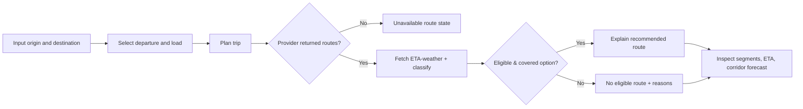

# 05 — User journeys, screen behavior and microcopy

## Primary journey

## Operational states and copy

| State | Primary heading | Action/behavior |
|---|---|---|
| Empty | Plan a weather-aware route | Clear four required fields |
| Invalid location | Select a recognized place | Inline suggestion + coordinate validation |
| Ambiguous place | Choose the correct location | List provider candidates, no silent guess |
| Loading | Checking truck routes and forecast | Phase text and accessible progress; allow cancellation |
| Fewer than 3 | 2 distinct truck routes available | Render actual routes; no fake third card |
| Eligible route | Lower forecast risk route | Explain Severe/High miles, time difference and freshness |
| All routes blocked | No eligible route for this forecast | Indicate No Travel segments and alternatives in time only if actually recalculated |
| Partial coverage | Weather coverage incomplete | Disable recommendation badge and clearly show unknown miles |
| Forecast limit | Some trip segments are beyond available forecast | Mark uncovered segments as unknown |
| Provider down | Routing or weather unavailable | Retry, no fallback 'safe' guess |
| Saved result stale | Forecast updated since this plan | Prompt to recalculate; show timestamps |
| 0–48h scrub | Forecast for [timestamp] | Display time-slice weather only; do not silently change route ranking |

## Desktop composition

Header: product mark and restrained controls. Left (or overlaid) planner/result panel: key input controls and comparison. Right: dominant interactive map, with all candidate routes distinguishable. Lower map area: compact 0–48h slider with timestamps and an overlay legend. Checkpoint selection opens a compact detail, anchored to the map when practical. Keep selected route and alert text visible.

## Mobile composition

Map takes primary visual space. Bottom sheet has collapsed summary, mid-height route comparison, expanded full planner/route detail. Forecast timeline is touch-friendly; status messages are reachable without covering navigation. Long controls scroll within sheet, not behind it. No hover-only feature.

## User decisions

- Selecting a route changes highlighted geometry and details; selection is NOT a new recommendation.
- Changing load or departure invalidates earlier risk results and requires recomputation.
- Changing display checkpoint spacing changes visible markers and detail sampling; it MUST NOT lower conservative risk-scoring resolution.
- Changing forecast slider changes overlay timestamp; should not alter trip-arrival recommendation unless explicitly recalculated.
- Do not show an unverified “safe” state for blocked or unknown portions.
