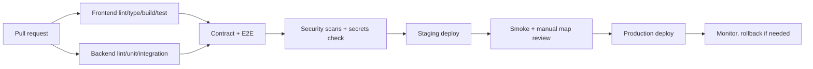

# 14 — Local execution, staging, production and recovery

## Deployment topologies

### Local

Use Docker Compose for PostgreSQL and Redis; run Django + Vite directly for faster iteration, or Compose all services. Configure from `.env` (noncommitted) based on `.env.example`. Verify health, migrations and geocoder/provider access. Fixture mode is labeled and never confused with live.

### Hosted assessment

Static frontend hosting on a CDN, one or more Django API instances, managed PostgreSQL if persistence enabled, Redis if queue/cache enabled and Celery worker if async planning is used. Custom domains optional. HTTPS, server-side provider credentials and provider attribution are required.

### Enterprise growth path

Scale API replicas on request utilization/latency, worker replicas on queue depth and provider quota; add WAF, centralized logs/traces and dedicated read replicas only when measured. Avoid claiming disaster recovery without testing backups/restores.

## Environment validation

- Backend fails fast on missing required secrets for live mode, invalid database/Redis connection, malformed allowed origin, malformed timeout/limit config.
- Production must reject `DEBUG=True`, permissive CORS/hosts, unauthorized fixture fallback and provider debug traces.
- Set `CSP`, HSTS, secure cookie settings where relevant; allow required map tile origins deliberately.
- Version database migrations; deploy schema backward-compatible before new app versions where possible.

## Release pipeline

## Incident/rollback plan

- Routing provider outage: fail clearly, bounded retries; never switch to fabricated route.
- Weather outage: route geometry may render without recommendation; status `insufficient_weather_data` and retry later.
- Redis unavailable: if async required, return `503` and retry; do not silently lose jobs or misrepresent completion.
- Database unavailable: readiness fails, return predictable error and preserve logs without user coordinates.
- Bad policy release: use versioned policy and rollback; invalidate caches keyed by policy version.
- Inconsistent risk results: disable recommendations via centrally controlled feature flag, continue displaying routes and marked unknown weather only if appropriate.

## Operational handoff

Document exact start/stop commands, live URL, deployed versions, migrations, worker count, monitoring dashboard, owner of external API bills, secret rotation contacts, cache freshness policy, backup/restore evidence, incident contacts and actual runbook status. No generic fictional URLs or pass claims.
